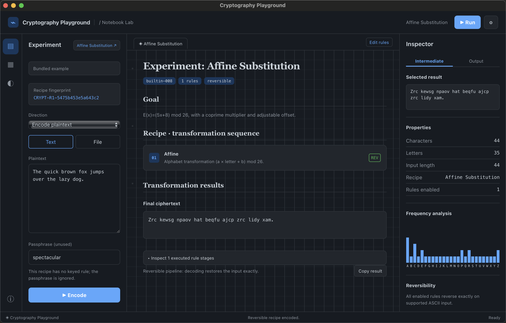
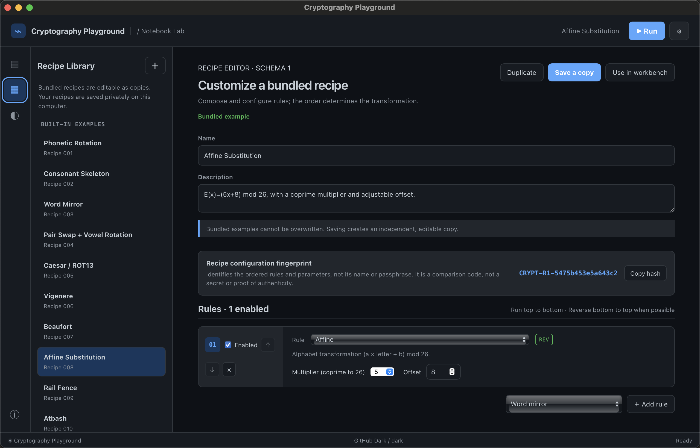
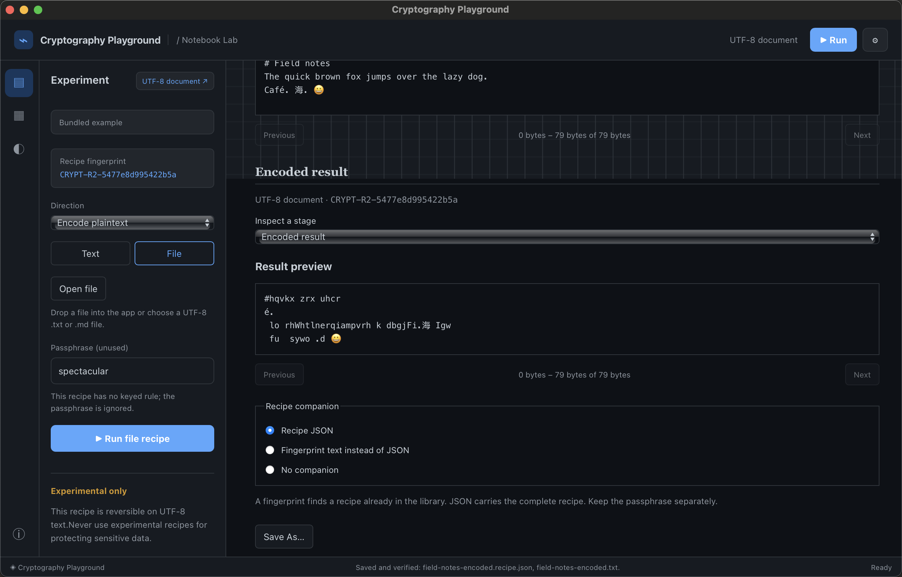

# Cryptography Playground

A desktop notebook for composing toy ciphers, inspecting each transformation, and exploring what a decoder can recover.

Built with Rust, Tauri 2, React, and TypeScript. **These experimental and historical ciphers are for puzzles and learning, not for protecting sensitive information.**

## Download the preview

[Download Preview 1 for Windows, Intel Mac, or Ubuntu](https://github.com/zevarix/cryptography-playground/releases/tag/v0.1.0-preview.1), with platform instructions and SHA-256 checksums.

- **Windows x64:** extract the portable ZIP with its notices directory. Requires Microsoft Evergreen WebView2 Runtime.
- **Intel macOS:** extract the ZIP containing the unsigned, unnotarized app. Tested on macOS 15.8.1; follow the release's per-app opening guidance if needed.
- **Ubuntu 24.04 x64:** install the unsigned Debian package using the release instructions. GTK/WebKit dependencies are supplied by apt.

Apple Silicon, older macOS versions, and other Linux distributions or architectures have not been verified. These are unsigned preview builds; SHA-256 checksums verify download integrity, not publisher identity.

## What you can do

- Build recipes from configurable rules, enable or reorder steps, and inspect intermediate text.
- Create, duplicate, import, and save recipes as local JSON. The 14 bundled examples use the same schema.
- Combine phonetic rotation, consonant skeletons, word mirroring, vowel rotation, and positional shifts with Caesar/ROT13, Vigenere, Beaufort, Affine, Atbash, and Rail Fence.
- Compare recipe configurations using a reproducible `CRYPT-R1-...` or `CRYPT-R2-...` fingerprint. Optional derived rules choose parameters from the configuration and runtime passphrase.
- Open UTF-8 `.txt` and `.md` files, inspect bounded previews, and save new results with an optional recipe JSON or fingerprint companion.
- Customize the notebook's light/dark appearance, theme, accent, colors, and font.

A recipe fingerprint identifies its configuration. It is not a secret key, signature, or proof of authenticity.

## Showcase

Run a recipe and compare its output, character counts and letter frequencies.



<details>
<summary>Recipe editor and file workflow</summary>

Configure ordered rules and parameters, then save an independent copy of a bundled recipe.



Process a UTF-8 document and save its result with recipe JSON, a fingerprint companion, or no companion.



</details>

These native Intel Mac screenshots use bundled recipes and synthetic sample text.

## Reversible steps and lossy guesses

Reversible legacy recipes decode supported ASCII input exactly. Version 2 recipes support UTF-8 documents, preserving case, punctuation, whitespace and non-ASCII text according to each rule. Rules that discard phonetic or spelling information cannot recover the original text uniquely.

For supported lossy recipes, the decoder keeps the exact surviving intermediate separate from a speculative English reconstruction. For example, **fox** and **fix** can share the same phonetic transform. Select alternative words to explore candidates that still re-encode consistently; a compatible candidate is not proof of the original plaintext.

Recipe 001 uses the Carnegie Mellon Pronouncing Dictionary. Unsupported words fail explicitly. The ranking vocabulary comes from wordfreq and is only a heuristic.

## Recipes and local storage

Use the **Recipes** panel to create or duplicate a recipe, configure its rules, then save it. Unsaved edits are marked and are lost when the app restarts. Saved custom recipes live in a `recipes` directory under Tauri's app-data directory. Appearance preferences are stored in the local WebView.

Copy JSON to share a recipe, or import a pasted/selected JSON file. Passphrases are not included in recipe JSON. In **File** mode, native **Save As** creates new files without replacing the original or an existing destination. File results and intermediate stages are temporary and disappear when the app closes; save results you want to keep.

- [Opening files, saving results and recipe companions](docs/text-files.md)
- [Recipe format and all bundled examples](docs/recipe-format.md)
- [Fingerprint and derived-parameter specification](docs/recipe-fingerprints.md)
- [Classical cipher adapters and test vectors](docs/classical-cipher-adoption.md)
- [Recipe 001 phonetic rules](RECIPE-001.md)

## Build from source

Install a current stable Rust toolchain, Node.js 22.12 or newer supported by Vite, and the [Tauri platform prerequisites](https://v2.tauri.app/start/prerequisites/):

- **Windows:** Microsoft C++ Build Tools with the desktop C++ workload, plus WebView2.
- **macOS:** Xcode Command Line Tools or Xcode.
- **Linux:** the distribution-specific WebKitGTK 4.1 and other native development libraries listed in the Tauri guide.

From a checkout:

```sh
npm ci
npm run tauri dev
```

Build the frontend or an unbundled local desktop executable:

```sh
npm run build
npm run tauri build -- --no-bundle --no-sign -- --locked
```

The desktop executable is written under `src-tauri/target/release/`. The frontend build alone is not the native application. Native testing has covered Windows and Intel macOS. Linux CI builds and smoke-tests the application on Ubuntu 24.04 x64. Apple Silicon has not been verified.

[Build unsigned preview ZIPs or a Linux Debian package](docs/preview-packages.md) with dependency notices, source manifests and SHA-256 checksums.

## Checks

```sh
cargo fmt --manifest-path src-tauri/Cargo.toml --package cryptography-playground -- --check
cargo test --manifest-path src-tauri/Cargo.toml --locked
cargo clippy --manifest-path src-tauri/Cargo.toml --locked --all-targets -- -D warnings
npm run build
```

Formatting targets project-owned code; retain the [GLib security backport](src-tauri/vendor/README.md) without unrelated formatting changes. On Linux, also run its optimized regression and verify the selected dependency graph:

```sh
cargo test --manifest-path tests/glib-regression/Cargo.toml --release --locked
python3 ci/check_glib.py
```

For the isolated frontend smoke test, set `CHROME_EXECUTABLE` to an installed Chromium-family browser executable and run `npm run test:gui`. It launches a separate headless browser and mocks Tauri commands; it does not establish native cipher or filesystem correctness. Screenshots are written to ignored `test-artifacts/`.

See [CONTRIBUTING.md](CONTRIBUTING.md) for the check workflow and native acceptance requirements.

## Licensing and project status

Project-original code and documentation are licensed under the [MIT License](LICENSE). Third-party materials retain their own terms.

Bundled dictionaries, ranking data, and adapted theme palettes retain their own licenses and attribution. See [THIRD_PARTY.md](THIRD_PARTY.md), [theme notices](docs/theme-attributions.md), and the [binary-release checklist](docs/public-readiness.md).

Report ordinary bugs through GitHub issues. For vulnerabilities or sensitive reports, follow [SECURITY.md](SECURITY.md).
